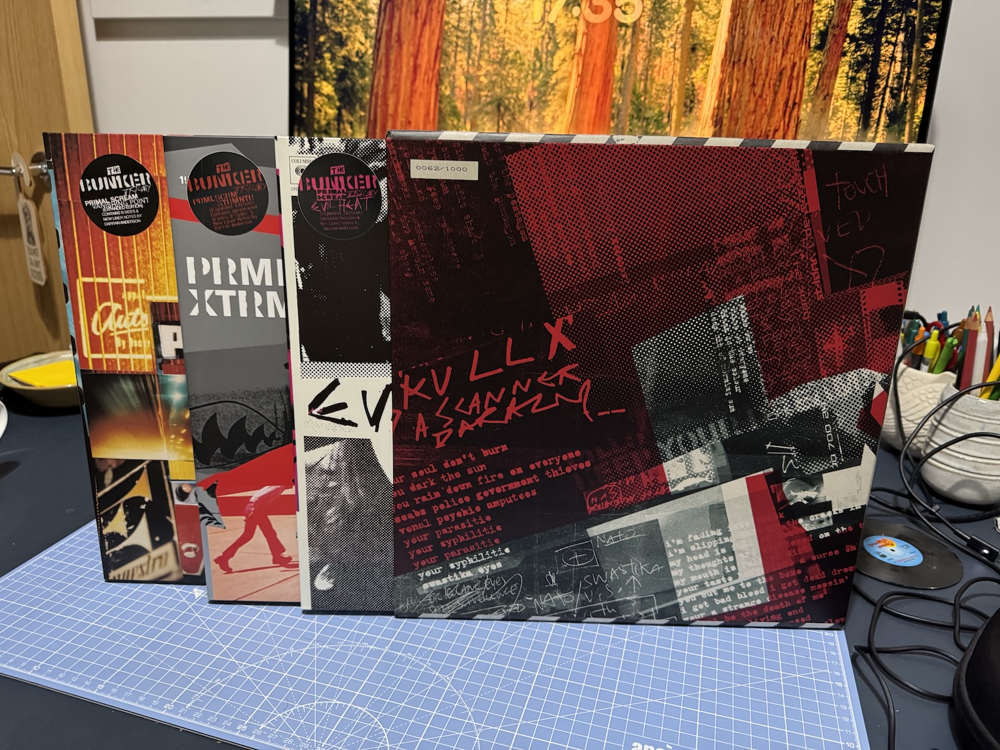

The latest installment of vinyl-related retail therapy sees the arrival of "The Bunker Trilogy", a slipcase for three double vinyl reissues by Primal Scream.

The albums in question are "Vanishing Point" (1997) on clear vinyl, "XTRMNTR" (2000) on see-through red vinyl, and "Evil Heat" (2002) on see-through pink vinyl. Each reissue has the original album over three sides of vinyl, with bonus tracks on side 4. There's a 90cm x 60cm poster with each record. The set came with a 12" of "If They Move, Kill 'Em" that has the My Bloody Valentine remix (also included on "XTRMNTR") and the disco mix on side A and two Jesus and Mary Chain covers on side B. That's standard black vinyl, itself a relative rarity these days. The contents of the 12" are also on the double CD reissue of "Vanishing Point".

I've never thought of these albums as a trilogy, except possibly as "the last three decent albums Primal Scream made", but apparently they were all recorded in the same studio. They do have a similar feel to one another, getting progressively darker as they go on. 

There's also enough room in the box to take [the Record Store Day reissue of "Echo Dek"](https://recordstoreday.com/UPC/199584177410), the Adrian Sherwood dub remix of tracks from "Vanishing Point". That's a single piece of swirled red and black vinyl which looks beautiful. 

I've only listened to the first disc of "Vanishing Point" (and "Echo Dek") so far and it sounds really good: there's a lovely bass sound to the vinyl. The digital remaster on Apple Music also sounds excellent. I find myself hearing more in the music as I get older and I swear I can hear new elements in these remasters. I don't know if it is my memory playing tricks on me or if I'm noticing a few things that have been tweaked in the mix here and there.

I'd been considering including "Vanishing Point" in the [understated classics](/categories/understated-classics/) series, so I won't go into too much more detail about these albums. I played "XTRMNTR" to death when it first came out and tired of it a bit, but I've been listening to it on digital in anticipation of this box and it is way better than I remember. I got "Evil Heat" for £1 (!) a few years after its release, which was definitely a steal. For me, it's the weakest of these three, but it has also been the album I've most enjoyed re-listening to the because it feels newer to me.

I didn't notice until writing this post that the box itself is a numbered limited edition. Looks like I got number 62 of 1000, which is pretty sweet! It's a solid, quality box, plastered with a nice mash-up of the artwork from the three albums that captures the interchangeable elements of them really well. 