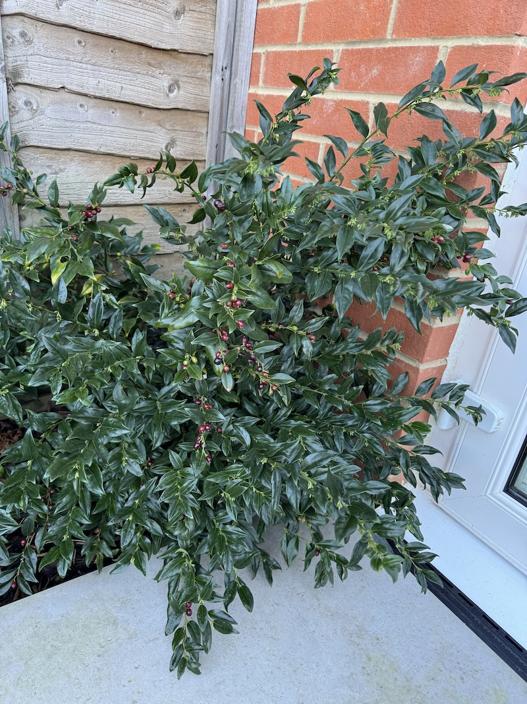
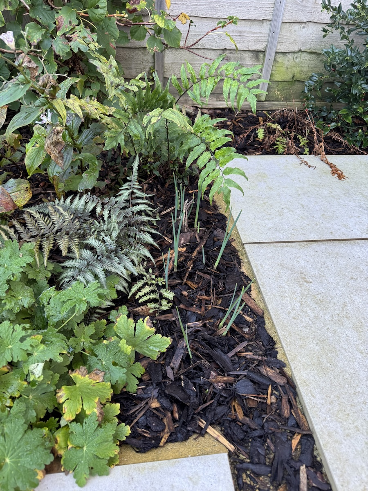
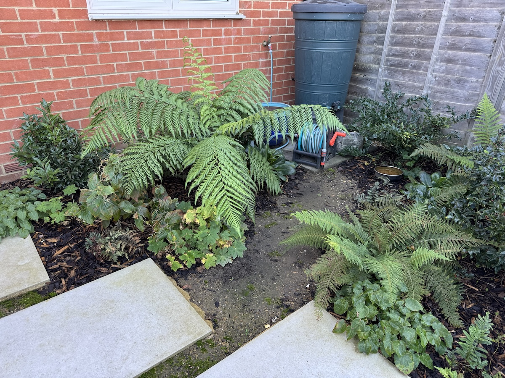
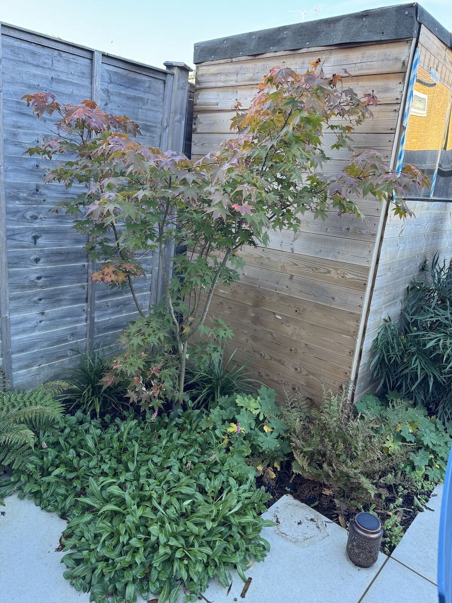
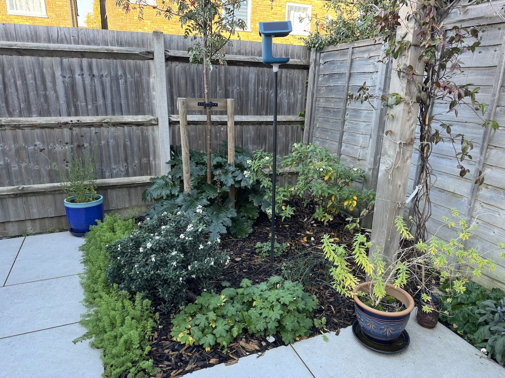
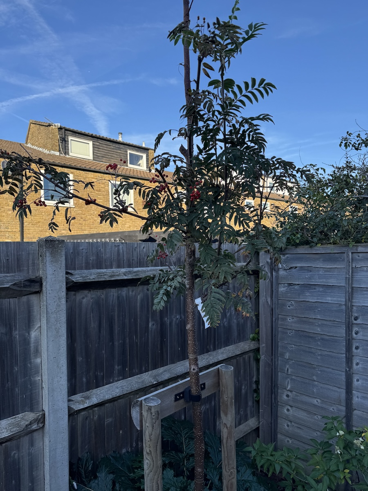
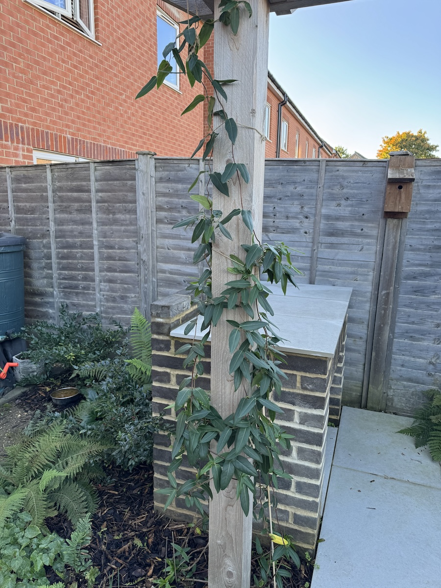

With everything else going on, I managed to take the time to pace around the garden this lunchtime. Despite the sunny day, now that it is autumn, it's a shadier garden, but there are plenty of plants flourishing and flowering.

In the hero image above, the plant with the striking yellow flowers is a mahonia ('Sweet Caress').  The flowers are just opening, about the same time as last year. If last year is anything to go by and if we have a similarly mild autumn, they should keep going on towards Christmas. Even this week we've seen bees interested in them, and it's nice to know we have plants that are sustaining the bee population even as it gets colder. On the left, against the fence, is a rosemary. That also has a few flowers, it seems to just chuck a few new ones out every few months or so. We've been out to grab some for cooking with too. Elsewhere, you can see that a lot of the bedding flowers are nicely established, with a few in the last moments of flowering.

By the back door we have a Sarcococca. It has glossy, pointed evergreen leaves, and the berries are dark red turning black. You can see the tiny flower buds along the stems. They'll open in Decemeber and smell wonderful if last year is anything to go by. We missed most of it but they were very aromatic by the back door when we got back from Australia.

The garden is full of shady, ferny corners with Japanese painted ferns (the silvery, almost metallic one) and holly ferns (the paler one behind). We have also got hardy geraniums and toad lillies. Also, poking through the wood bark are some bulb shoots. Ingrid planted these all over the garden no more than six weeks ago and they have started to poke out of the ground already. 

The main fern bed is in front of the kitchen window by the water butt. The tree fern goes from strength to strength with great arching fronds. I like spotting the new leaves as they emerge: they look like little alien pinwheels. Bottom right is a soft shield fern, which has more finely cut, feathery fronds. They've got healthy competition from various other bits of ground cover. There are dark glossy evergreen shrubs on both sides: I can't remember what these were but I think there is at least one other Sarcococca variant there. More hardy geraniums and another painted fern fill out space on the left. If more bulbs decide to make an early run for it, we might see some here too.

The Japanese maple is much happier this year and actually progressing through autumn colours, with green turning to orange, coral and rusty red. Last year it worried us a bit by all dying off at once, but it seems to have rallied. We sought to persuade it by giving it a good feed in the spring and Ingrid made sure it was well watered through the heatwaves. We dilligently saved up grey water specially. Below the Japanese maple is a thick carpet of persicaria with a few pink spikes and some grassy clumps: the flowers have been and are now mostly gone. There are more geraniums and ferns. There's a second mahonia on the far right and its yellow flowers add a bit more colour.

Around the bottom of the rowan, there's a large unruly acanthus at the back which has really grown up this year. I'm not even sure if it was planted or just blew in and established itself. This bed has had some colourful bulbs sprout up this year including some stunning aliums. At the back right is a hydrangea, which is still not quite established and has spent most of the summer looking rather frazzled. The ground cover on the left, we have no idea what it is: it might just be something that piggy-backed in with the decorative bark. In the pot at the back we've had some lovely purple flowers all summer, while in the navy pot is a rangy lemon verbena with lovely smelling leaves. At the front right there's also some sage which seems to be doing okay. On the pergola, the Jasmine has rallied but is starting to feel the cold a bit.

The young rowan up close. It's still establishing but seems happier than it did last summer. It has feathery leaves and clusters of orange berries against the blue sky. We are hoping that they feed the birds over the winter. (Mostly because I forget to keep topping up the bird feeder!)

The honeysuckle - a gift from my parents - is being trained to run up the side of the pergola. It's not flowered that much this year, but it's far bigger than the little pot it arrived in. Its tendrils have been ranging all over the place all year, if Ingrid hadn't trained it to the post, the ferns would probably have got a restraining order.

